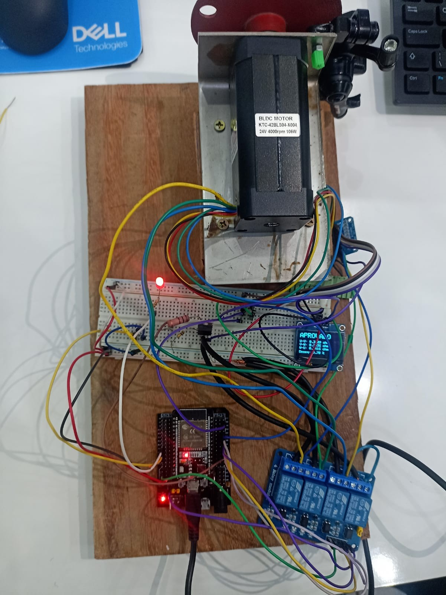
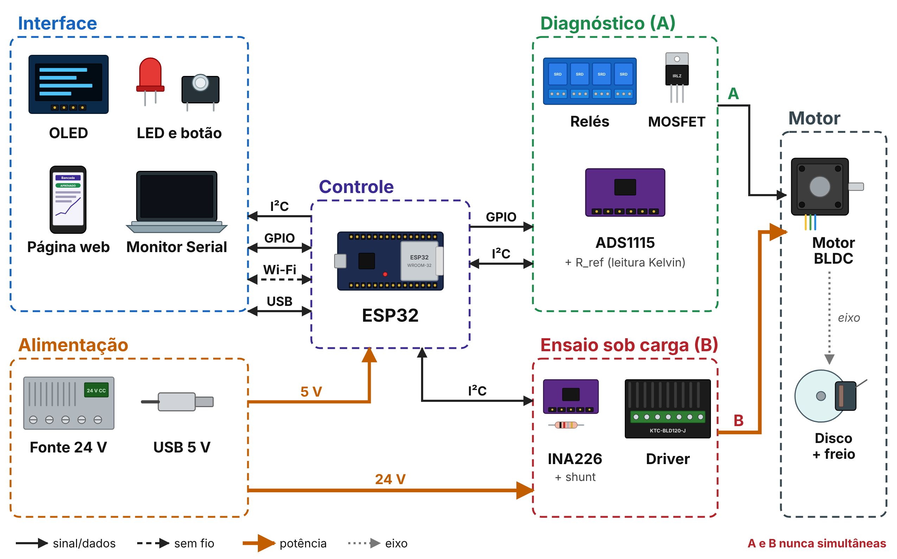

# Bancada de testes para diagnóstico elétrico e acionamento de compressores BLDC inverter

Projeto Final de Curso (PFC) – Bacharelado em Engenharia de Controle e Automação  
Faculdade Engenheiro Salvador Arena – São Bernardo do Campo, SP

**Autores:** Antônio Jack S. Monte · Giovanna A. Gonçalves · Jackson G. Cerqueira · José de Jesus Amaral · Júlia R. Lima  
**Orientador:** Dr. Paulo César da Silva Emanuel

## Objetivo

Bancada que **verifica a integridade elétrica dos enrolamentos com o motor parado** e **só então libera o acionamento direto sob carga**, monitorando a corrente consumida, para ajudar o técnico de campo a decidir entre placa inversora e compressor sem arriscar o módulo de potência (IPM).

## Status

| Etapa | Situação |
|---|---|
| **1 – Prova de conceito** (motor BLDC 24 V KTC42BLS04-J + driver KTC-BLD120-J) | |
| Diagnóstico estático, medição a 4 fios (Kelvin) | ✅ Validado: motor sadio aprovado (desequilíbrio 0,78 %); curto U–V reprovado (115,95 %) |
| Intertravamento diagnóstico → acionamento | ✅ Validado: ensaio sob carga bloqueado quando reprovado |
| Ensaio sob carga com INA226 | ⏳ Não realizado nesta etapa (problema no módulo INA226) |
| **2 – Compressor hermético inverter** | 🔜 Planejada: isolação 500 V CC (IEEE Std 43-2013), barramento ~310 V, sem sensor Hall |

## Como funciona

- **Configuração A – diagnóstico estático:** relés selecionam o par de fases (U–V, V–W, W–U); corrente de ~68 mA pelo par; o ADS1115 lê a tensão diretamente nos terminais do motor (Kelvin) e no resistor de referência de 1 Ω. `R_par = R_ref × V_par ÷ V_ref`. Reprova se houver circuito aberto, leitura fora de escala ou desequilíbrio acima de 5 %.
- **Configuração B – ensaio sob carga:** motor ligado ao driver em 24 V; INA226 com shunt ≈ 0,0091 Ω no barramento (faixa ≈ 9 A). Linha de base em vazio, alerta em 2 × a linha de base, teto de ensaio de 4 A e estado TRAVADO, liberado só pelo botão físico.
- **Interface:** OLED na bancada, página web pelo Wi-Fi do ESP32 (192.168.4.1) e Monitor Serial; exportação em CSV.

## Estrutura do repositório

| Pasta | Conteúdo |
|---|---|
| `firmware/` | Código do ESP32 e instruções de gravação |
| `hardware/esquemas/` | Folhas 1 a 4 do esquema elétrico (Rev. B) e montagem do shunt |
| `hardware/diagrama_funcional/` | Diagrama funcional (simplificado e detalhado) |
| `hardware/lista_de_materiais.csv` | Componentes e custos (total R$ 1.133,02) |
| `docs/` | Procedimento da bancada e fluxograma do firmware |
| `ensaios/` | Dados dos testes iniciais e da prova de conceito |
| `pesquisa/` | Síntese anonimizada da pesquisa de campo exploratória |

## Como citar

MONTE, A. J. S. *et al.* **Bancada de testes para diagnóstico elétrico e acionamento de compressores BLDC inverter**. São Bernardo do Campo: Faculdade Engenheiro Salvador Arena, 2026. Repositório GitHub. Disponível em: `<link do repositório>`.

## Licença

A definir pelo grupo (sugestão: MIT para o código e CC BY 4.0 para documentos e figuras).
