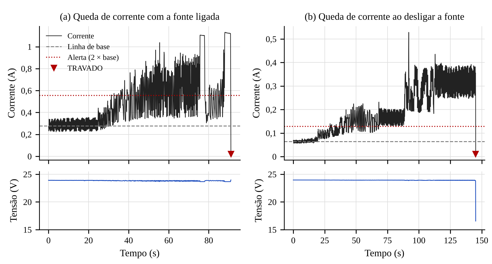

# Ensaio sob carga com a ligação de referência e diagnóstico com fase aberta (26/11/2026)

Nos dois casos, o diagnóstico estático foi feito com **resistores iguais em estrela** no lugar do motor (valor não anotado), para agilizar a sequência. O ensaio sob carga usou o motor KTC42BLS04-J no *driver* em 24 V, com carga aplicada pelo freio, e a ligação de referência entre o negativo da fonte e o GND do circuito de medição.

## Ensaio sob carga (`ensaio_sob_carga/`)

| Arquivo | Linha de base | Pico | Fim do ensaio |
|---|---|---|---|
| `ensaio_bancada 94.csv` | 0,28 A | 1,13 A | Corrente caiu para 0,02 A aos 91 s com a tensão em 24,0 V: atuação da proteção do *driver* → TRAVADO |
| `ensaio_bancada 93.csv` | 0,064 A | 0,53 A | Fonte desligada no botão aos 145 s: corrente e tensão caíram juntas (16,6 V) → também indicado como TRAVADO |

A tensão do barramento passou a ser lida corretamente (23,7 a 24,0 V com a fonte ligada). O segundo ensaio mostra uma limitação da lógica atual: como a decisão usa só a corrente, o desligamento da fonte também é indicado como TRAVADO. A tensão, agora registrada, permite separar os dois casos; a mudança está prevista para a etapa 2.

`grafico_corrente_e_tensao.py` gera a figura a partir dos dois CSVs: `python3 grafico_corrente_e_tensao.py "ensaio_sob_carga/ensaio_bancada 94.csv" "ensaio_sob_carga/ensaio_bancada 93.csv" corrente_e_tensao.png`.

## Fase aberta (`fase_aberta/`)

Uma fase desligada por vez. Os pares que incluem a fase solta não conduziram corrente (menos de 10 mV no resistor de referência) e aparecem como `null`, o que o firmware trata como circuito aberto e reprova o diagnóstico.

| Arquivo | Par com leitura | Fase desligada |
|---|---|---|
| `ensaio_bancada 95.csv` | V–W | U |
| `ensaio_bancada 96.csv` | U–V | W |
| `ensaio_bancada 97.csv` | W–U | V |

**Atenção:** o CSV exportado repete os dados do último ensaio sob carga junto com o diagnóstico novo. Nos arquivos 95 a 97, a parte de carga é a mesma do ensaio 94 e deve ser ignorada; vale só o cabeçalho de diagnóstico.
